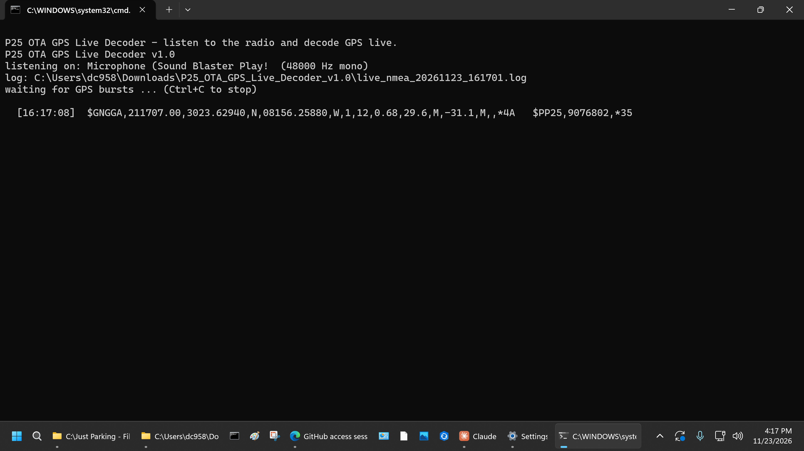

# P25-GPS-Decode

**Decode Tier 1 GPS location broadcast over the air on a P25 radio channel — from a receiver's discriminator audio, with a sound card, no SDR.**

> 🤖 **Using AI assistance?** Have the agent read [`CLAUDE.md`](CLAUDE.md) first, then [`docs/DECODE_PLAN.md`](docs/DECODE_PLAN.md).

## What this is

A radio set to a P25 channel already demodulates the signal — the **discriminator output** is the recovered 4-level baseband, before any digital processing. This project takes that audio into a PC sound card and decodes the **P25 Tier 1 location data** (position as NMEA, a regulated public-safety interoperability format) **straight off the air** — without asking the radio to hand it over, and without a software-defined radio.

The point is independence and reach:

- **No cooperating base radio.** Existing tools read GPS out of a specific manufacturer's base over a USB link. This reads it off the RF, from any compatible receiver's discriminator.
- **The whole P25 world, not one brand.** Tier 1 location is a common, regulated format across manufacturers.
- **Data, not voice.** We decode the location data units and ignore voice entirely — so there's no vocoder and none of the patent baggage that comes with P25 voice decoding.

## Status — proven LIVE over the air ✅

**2026-11-23, 16:17 — first live decode off a radio.** The live tool, listening to a radio's detector audio on a USB sound card, decoded a transmission the instant it keyed up — full position, valid checksum, correct unit ID — with no base radio, no SDR, no cooperating gateway:

```
[16:17:08]  $GNGGA,211707.00,3023.62940,N,08156.25880,W,1,12,0.68,29.6,M,-31.1,M,,*4A   $PP25,9076802,*35
```



Over-the-air decode is **demonstrated end to end,** live and from recordings. Fed a recording of a radio's discriminator audio, the decoder recovers each GPS report as the exact `$GNGGA` position + `$PP25,<unit-id>` sentence the fleet transmits — validated **character-for-character against a cooperating base's own NMEA feed** (the answer key) on two independent captures:

- A clean 10-report capture decoded **10 of 10 bursts**, with **latitude, longitude, unit ID and checksum exact on every one**.
- An earlier, partly-degraded capture decoded every adequately-received burst; the misses were a transient mid-recording RF condition, not a decoder limit (a clean capture clears them).

The decode chain (symbol recovery → P25 framing → Tier 1 data PDUs → NMEA) is ported from the open OP25 project, with a Viterbi decode of the 1/2-rate data blocks added to recover bursts OP25's greedy decoder drops. Full honest detail — what's proven, how it was validated, the remaining cosmetic residual (occasional single-glyph slips in the UTC *time* field only, never position/ID/checksum) — is in [`CLAUDE.md`](CLAUDE.md) and [`docs/DECODE_PLAN.md`](docs/DECODE_PLAN.md).

## The Universal Traveler

**⬇️ [Universal Traveler (PC) v1.1](Universal_Traveler_PC_v1.1.zip)** — the Traveler, fed by GPS decoded off the air, **no cooperating base in the chain.**

It's the [Traveler](https://github.com/Jim-dc95811/The-Lookout)'s own software — its locked split-screen map — with the input stage swapped. The decoder emits the same `$GNGGA`+`$PP25` NMEA on the same port (`:10110`) a BK base's bridge used, so the Traveler map server reads it **unchanged** — the OTA decoder is a byte-for-byte drop-in for the base feed. Extract, double-click `Start the Universal Traveler.bat`: it listens to the radio, serves the feed, and opens the live map at `http://localhost:8080` with every unit that keys up plotted and moving. Any P25 fleet, any receiver with detector audio. (Decode on the box itself is the next phase; this runs it on a PC.)

## Download the tools

Two Windows tools, same proven decode core — one reads a recording, one listens live.

**⬇️ [P25 OTA GPS Live Decoder v1.0](P25_OTA_GPS_Live_Decoder_v1.0.zip)** — listens to discriminator audio on a USB sound card and decodes each GPS report **the moment it keys up**, printing it and logging it live. This is the field front end (the live feed, no recordings). Extract, double-click `Listen for P25 GPS (live).bat`, pick the sound-card input, leave it listening. (Drag a `.wav` onto the `.bat` to self-check the decode path before wiring the radio.) Installs numpy, scipy and sounddevice on first run; the manual beside the `.bat` covers the wiring and Windows sound settings.

**⬇️ [P25 OTA GPS Decoder v1.0](P25_OTA_GPS_Decoder_v1.0.zip)** — turns a `.wav` recording of discriminator audio into NMEA. Extract, then **drag a recording onto `Decode P25 GPS from a recording.bat`**. Good for working from saved captures.

Both find every GPS report, print each as `$GNGGA` + `$PP25,<unit-id>`, and write a timestamped log in the same form as the reference feed, so the two diff line for line. Read-only throughout — a radio is never transmitted to or altered.

They are the over-the-air counterpart to the reference logger ([`rig/rndis_nmea_logger.py`](rig/rndis_nmea_logger.py)): that reads finished NMEA from a cooperating base; these decode the same NMEA from the raw air. The decode source lives in [`decode/`](decode/) (the streaming engine is [`decode/live_core.py`](decode/live_core.py)); `capture/` holds the sound-card capture settings for the discriminator input.

## License

MIT — see [`LICENSE`](LICENSE). This project distributes a tool, not any agency's data. It only ever *receives*; it never transmits or alters a radio. Users are responsible for the laws and licenses that apply where they operate.
